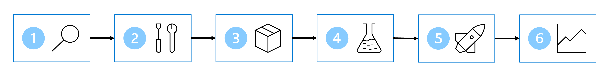

# Introduction

Thoughtfully designed machine learning solutions form the foundation of today's AI applications. From predictive analytics to personalized recommendations and beyond, machine learning solutions support the latest technological advances in society by using existing data to produce new insights.

Data scientists make decisions to tackle machine learning problems in different ways. The decisions they make affect the cost, speed, quality, and longevity of the solution.

In this module, you learn how to design an end-to-end machine learning solution with Microsoft Azure that can be used in an enterprise setting. Using the following six steps as a framework, we explore how to plan, train, deploy, and monitor machine learning solutions.

1. Define the problem: Decide on what the model should predict and when it's successful.
2. Get the data: Find data sources and get access.
3. Prepare the data: Explore the data. Clean and transform the data based on the model's requirements.
4. Train the model: Choose an algorithm and hyperparameter values based on trial and error.
5. Integrate the model: Deploy the model to an endpoint to generate predictions.
6. Monitor the model: Track the model's performance.

Next, let's look at how we can get started on a machine learning solution by defining the problem.

## [[Unit 1 - Define the problem| Next Unit > Define the problem]]