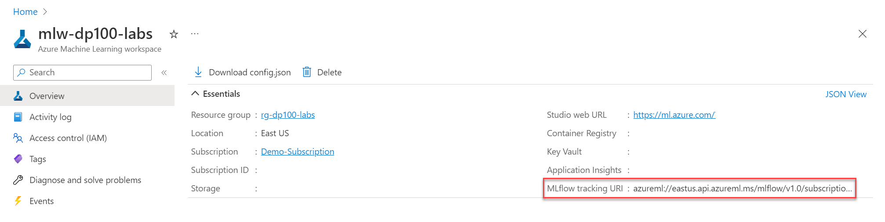

# Configure MLflow for model tracking in notebooks

Working in a notebook lets you experiment interactively and iterate quickly. To make that experimentation meaningful, you need to track what you try. Without tracking, it's easy to lose sight of which configuration produced which result.

**MLflow** is an open-source library for tracking and managing your machine learning experiments. In particular, **MLflow Tracking** is a component of MLflow that logs everything about the model you're training, such as **parameters**, **metrics**, and **artifacts**. This means you can compare your notebook runs directly against the models AutoML trained, all in one place.

To use MLflow in notebooks in the Azure Machine Learning workspace, you need to install the necessary libraries and set Azure Machine Learning as the tracking store.

## Configure MLflow in notebooks

You can create and edit notebooks within Azure Machine Learning or on a local device.

### Use Azure Machine Learning notebooks

Within the Azure Machine Learning workspace, you can create notebooks and connect the notebooks to an Azure Machine Learning managed compute instance.

When you're running a notebook on a compute instance, MLflow is already configured, and ready to be used.

To verify that the necessary packages are installed, you can run the following code:

```python
pip show mlflow
pip show azureml-mlflow
```

The ```mlflow``` package is the open-source library. The ```azureml-mlflow``` package contains the integration code of Azure Machine Learning with MLflow.

### Use MLflow on a local device

When you prefer working in notebooks on a local device, you can also make use of MLflow. You need to configure MLflow by completing the following steps:

1. Install the mlflow and azureml-mlflow package.

    ```python
    pip show mlflow
    pip show azureml-mlflow
    ```

2. Navigate to the Azure Machine Learning studio.

3. Select the name of the workspace you're working on in the top right corner of the studio.

4. Select View all properties in Azure portal. A new tab opens to take you to the Azure Machine Learning service in the Azure portal.

5. Copy the value of the MLflow tracking URI.

    

6. Use the following code in your local notebook to configure MLflow to point to the Azure Machine Learning workspace, and set it to the workspace tracking URI.

    ```python
    mlflow.set_tracking_uri("MLFLOW-TRACKING-URI")
    ```

When you configured MLflow to track your model's results and store it in your Azure Machine Learning workspace, you're ready to experiment in a notebook.

## [[Unit 6 - Train and track models in notebooks| Next Module > Train and track models in notebooks]]
