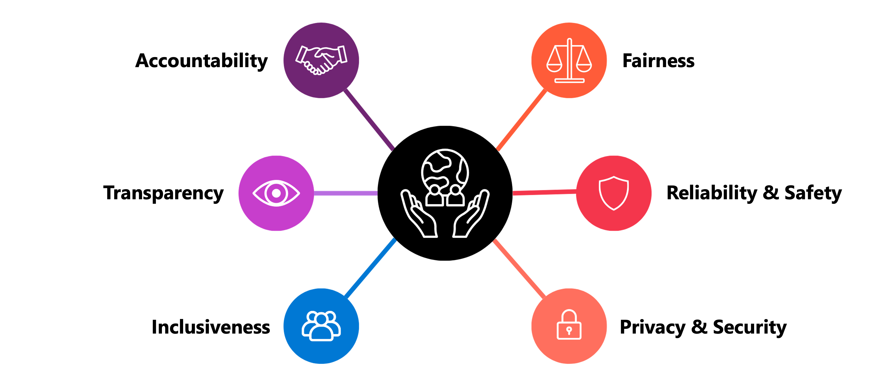
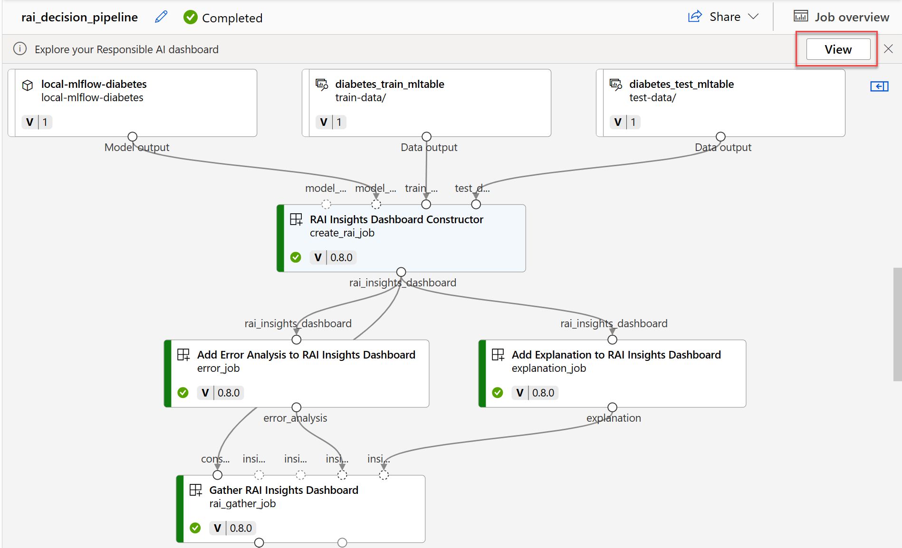
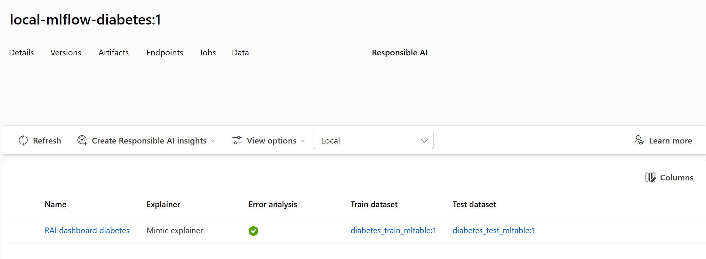
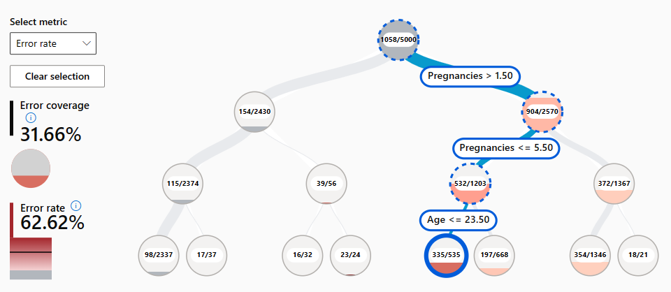
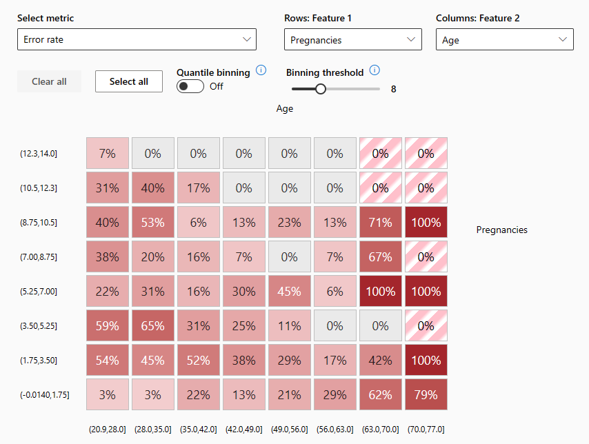
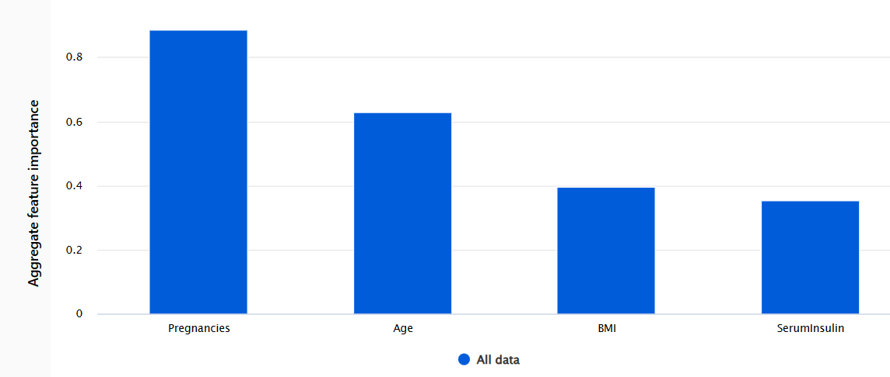
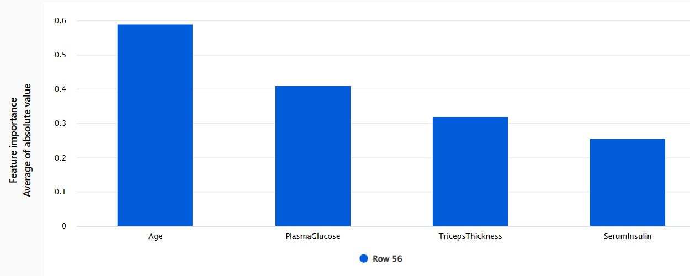

# Evaluate models with the Responsible AI dashboard

After training a model in a notebook, you want to evaluate it — not just for accuracy, but also for fairness, transparency, and reliability. Azure Machine Learning's **Responsible AI dashboard** brings these evaluations together in one interactive view.

## Why responsible AI matters

Models are often used when making consequential decisions. Whatever your model predicts, you should consider Microsoft's six **Responsible AI principles**:



- **Fairness**: Ensure your model provides equitable outcomes by testing for and mitigating harmful bias across groups.
- **Reliability & Safety**: Build, test, and monitor your model so it performs consistently and prevents unsafe behavior.
- **Privacy & Security**: Protect user data through minimal collection and responsible data-handling practices.
- **Inclusiveness**: Design and evaluate systems so people of diverse abilities and backgrounds can use them effectively.
- **Transparency**: Communicate clearly how your model works and how its outputs should be interpreted.
- **Accountability**: Assign human oversight so decisions influenced by AI remain traceable and governed.

## Create a Responsible AI dashboard

To generate a Responsible AI (RAI) dashboard, you create a **pipeline** using Azure Machine Learning's built-in RAI components. The pipeline must:

1. Start with the ```RAI Insights dashboard constructor```.
2. Include one or more RAI tool components for the insights you need.
3. End with ```Gather RAI Insights dashboard``` to collect everything into one dashboard.

The available RAI tool components are:

- ```Add Explanation to RAI Insights dashboard```: Shows how much each feature influences the model's predictions.
- ```Add Error Analysis to RAI Insights dashboard```: Identifies subgroups of data where the model makes more errors.
- ```Add Counterfactuals to RAI Insights dashboard```: Explores how changes in input would change the model's output.
- ```Add Causal to RAI Insights dashboard```: Uses historical data to estimate the causal effect of features on outcomes.

You can build this pipeline using the Python SDK, the CLI, or the no-code experience in Azure Machine Learning studio.

## Explore the dashboard

Once the pipeline completes, you can open the **Responsible AI dashboard** from the pipeline overview, or from the **Responsible AI** tab of the registered model in the studio.



Alternatively, find the dashboard in the **Responsible AI** tab of the registered model.



### Error analysis

Error analysis shows how prediction errors are distributed across your dataset. You can use the **error tree map** to find combinations of subgroups with higher error rates, or the **error heat map** to see errors across one or two features.





### Explanations

Feature importance tells you how much each input feature influences the model's predictions. **Aggregate feature importance** shows overall influence across your test data; individual feature importance shows the influence for a single prediction.





