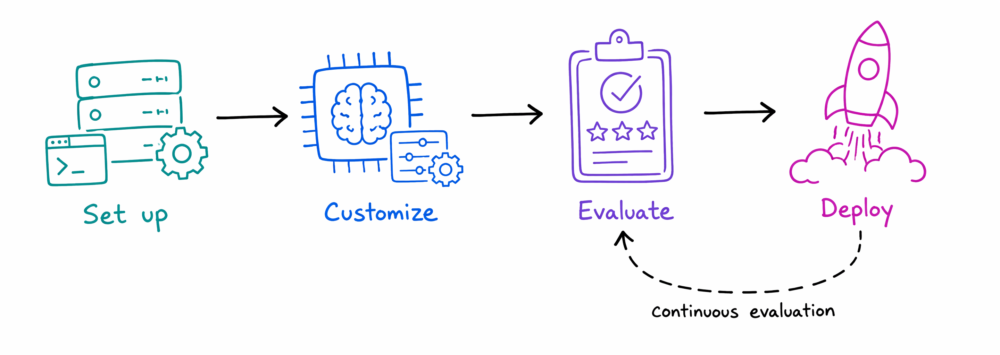
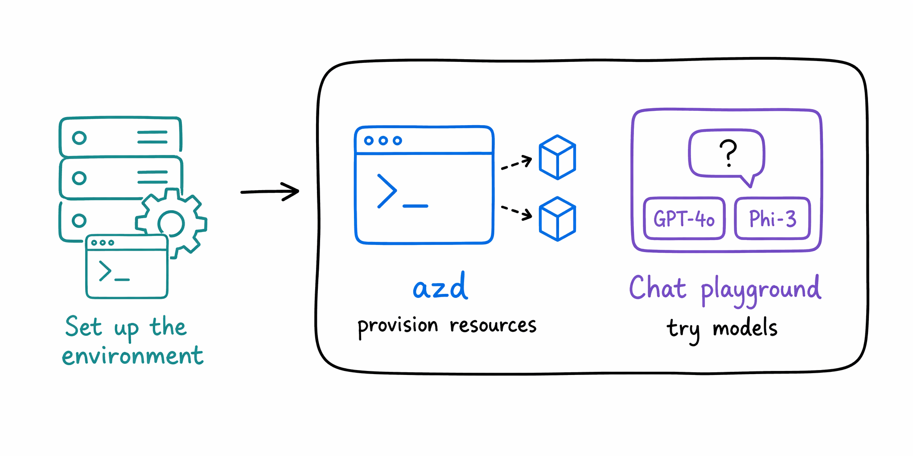
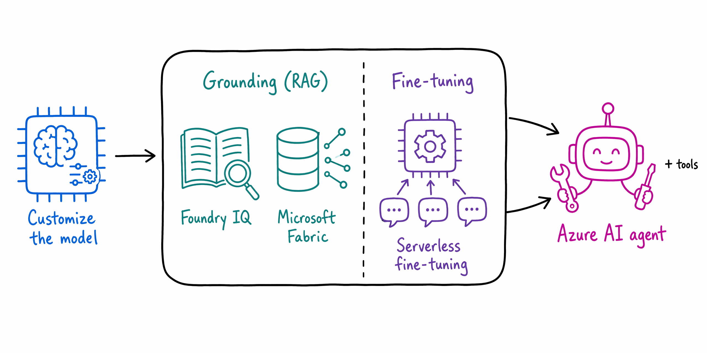
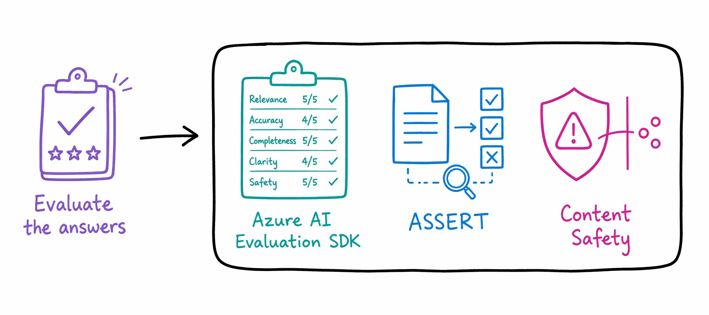
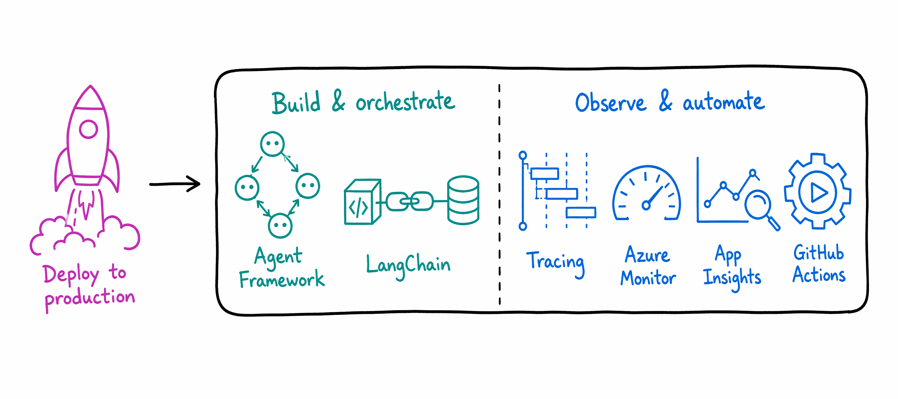

# Explore available tools and frameworks to implement GenAIOps

By now the Adventure Works team has planned and designed their agent: an assistant that answers shopper questions on their outdoor-gear website. What they don't have yet is a working, reliable service—and getting there takes the right tool at each stage.

The journey runs through four phases: setting up an environment, customizing the model, evaluating its answers, and deploying to production. Here are the tools that carry the agent through each one.

## Set up the environment

Before the team can build anything, they need a place to work. Standing up services and configuration by hand is slow and error-prone, so Adventure Works uses the [**Azure Developer CLI**](https://learn.microsoft.com/en-us/azure/developer/azure-developer-cli/) (**azd**) with a prebuilt [AI app template](https://learn.microsoft.com/en-us/collections/5pq0uompdgje8d?sharingId=ADFFF9D4AD9A0F29&amp;WT_mc.id=aip-114567-cassieb&amp;azure-portal=true) to provision and deploy everything they need in a few commands.

With the environment ready, they explore models in **Microsoft Foundry**. In the Foundry portal, they open the [**Chat playground**](https://learn.microsoft.com/en-us/azure/foundry/concepts/concept-playgrounds) and fire real shopper questions—*"Which tent handles winter camping?"*—at different models to see which answers most naturally before committing.

## Customize the model

A base model knows a lot about the world but nothing about Adventure Works' current inventory. The team closes that gap two ways. **Retrieval Augmented Generation (RAG)** lets the agent search the live product catalog and answer from what it finds, so recommendations always reflect what's in stock. They build this on [**Foundry IQ**](https://learn.microsoft.com/en-us/azure/foundry/agents/concepts/what-is-foundry-iq), a managed, permission-aware knowledge layer over Azure AI Search, and can store and search embeddings in [**Microsoft Fabric**](https://techcommunity.microsoft.com/blog/startupsatmicrosoftblog/building-high-scale-rag-applications-with-microsoft-fabric-eventhouse/4217816) Eventhouse. **Fine-tuning** instead trains the model on examples—like past support chats—to lock in the brand's friendly tone, and [**serverless fine-tuning**](https://learn.microsoft.com/en-us/azure/foundry-classic/concepts/fine-tuning-overview) does it without managing infrastructure. Adventure Works leads with RAG for freshness and layers in fine-tuning for voice.

These are complementary, not competing. To act on those answers, the team wraps the model in an [**Azure AI agent**](https://learn.microsoft.com/en-us/azure/foundry/agents/overview). The agent brings the pieces together—it grounds its replies with RAG, runs on the fine-tuned model, and calls tools like catalog search and purchase history—so it can recommend and compare gear on a shopper's behalf. A customized agent still needs proof that it answers well. That's what evaluation delivers.

## Evaluate the answers

Before the agent goes live, Adventure Works scores its answers against a **rubric**—a scoring guide that spells out what a good response looks like, such as relevant, grounded in real product data, and friendly in tone.

The [**Azure AI Evaluation SDK**](https://learn.microsoft.com/en-us/azure/ai-foundry/how-to/develop/evaluate-sdk) runs this scoring automatically, with built-in evaluators for quality (groundedness, relevance, coherence), safety (harmful or biased content), and agent behavior (intent resolution, tool-call accuracy, task adherence), plus custom evaluators for your own criteria.

To catch regressions, the team uses [**ASSERT**](https://learn.microsoft.com/en-us/azure/foundry/observability/how-to/evaluate-agent) (Adaptive Spec-driven Scoring for Evaluation and Regression Testing), which turns the agent's rules—like *never invent a discount*—into automated tests and links each failure back to the exact request and reason, so the team knows *why* the agent fell short.

And because a public-facing agent can't afford an offensive answer, [**Microsoft Foundry Content Safety**](https://learn.microsoft.com/en-us/azure/ai-services/content-safety/overview) flags harmful or biased responses before they reach a shopper.

## Deploy to production

With the agent scoring well, it's time to ship. Adventure Works needs it running reliably on the website, updating without downtime, and watched closely once real shoppers arrive.

To build and orchestrate the agent, Microsoft recommends the [**Microsoft Agent Framework**](https://learn.microsoft.com/en-us/agent-framework/overview/), an open-source SDK for C# and Python that unifies Semantic Kernel and AutoGen so you can build single and multi-agent workflows one consistent way—with migration guides if you already have code in either. [**LangChain**](https://learn.microsoft.com/en-us/azure/ai-foundry/how-to/develop/langchain) is a popular alternative for connecting models to external data, APIs, and memory.

Once it's live, the team keeps the agent healthy with a stack that builds on itself. [**Tracing**](https://learn.microsoft.com/en-us/azure/foundry/observability/concepts/trace-agent-concept) records each request—which tools the agent called and why it answered as it did. [**Azure Monitor**](https://learn.microsoft.com/en-us/azure/azure-monitor/overview) and [**Application Insights**](https://learn.microsoft.com/en-us/azure/azure-monitor/app/app-insights-overview) collect those traces alongside metrics like latency, token usage, and error rates, so the team spots trouble in real time. [**GitHub Actions**](https://docs.github.com/actions) ships new versions automatically.

This closes the loop: production traffic feeds continuous evaluation that re-scores live answers against the same rubric. If quality drifts, the team catches it and cycles back to improve the agent—the same planning discipline that got it launched now keeps it trustworthy.

## [[Unit 7 - Module assessment| Next Unit > Module assessment]]
